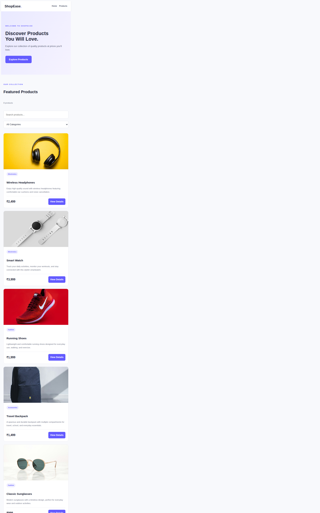
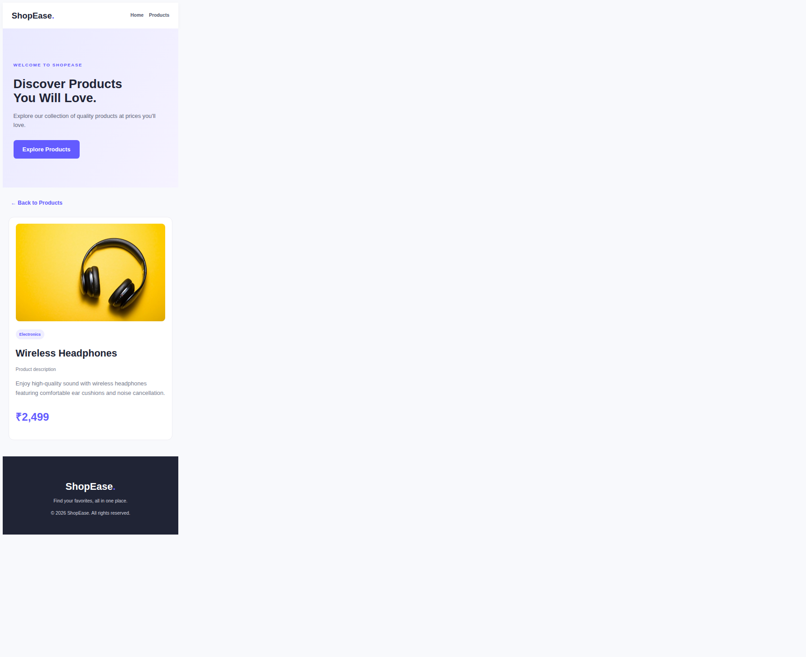

# ShopEase Product Store

A small full-stack product listing website. The browser loads product data from a FastAPI backend, and the backend reads it from a SQLite relational database.

## Prerequisites

- Python 3.10 or later
- `pip` and Python's `venv` module

On Ubuntu, if creating a virtual environment reports that `ensurepip` is unavailable, install the matching venv package (for example, `sudo apt install python3-venv`).

## Run Locally

From the project directory, create and activate a virtual environment, install dependencies, initialize the sample database, and start the web server:

```bash
python3 -m venv .venv
source .venv/bin/activate
python -m pip install -r requirements.txt
python init_db.py
python -m uvicorn main:app --reload
```

Open <http://127.0.0.1:8000/> for the website. FastAPI's interactive API documentation is at <http://127.0.0.1:8000/docs>.

The initializer creates `products.db` using `schema.sql` and imports the sample records from `products.json` when the `products` table is empty. The database file is generated locally and is not included in Git. To recreate a fresh sample database, stop the server, remove `products.db`, and run `python init_db.py` again.

## Project Structure

```text
index.html                 Storefront markup
style.css                  Storefront styles
script.js                  Browser code; requests product data from the API
main.py                    FastAPI app, web routes, and product API
database.py                SQLite setup and product queries
schema.sql                 Relational table definition
products.json              Sample product records used to seed a fresh database
init_db.py                 Database initialization command
requirements.txt            Python dependencies
screenshots/                Product listing and product detail screenshots
```

## Architecture

The frontend, backend, and database run on one computer and share the FastAPI server origin. FastAPI serves the storefront files and JSON API. The browser requests product listings and individual details from the API; it does not fetch `products.json` directly. The backend validates API responses with Pydantic and queries SQLite through parameterized SQL. SQLite is included with Python, so no separate database server is needed.

The `products` table uses `id` as its primary key and stores `name`, `description`, `price`, `category`, and `image`. Required fields are non-null, and the database prevents negative prices.

## API Endpoints

| Method | Path | Result |
| --- | --- | --- |
| `GET` | `/api/products` | Returns the product catalogue. |
| `GET` | `/api/products/{product_id}` | Returns one product; responds with `404` when it does not exist and `422` for an invalid ID. |

## Screenshots

**Product listing**



**Product details**

